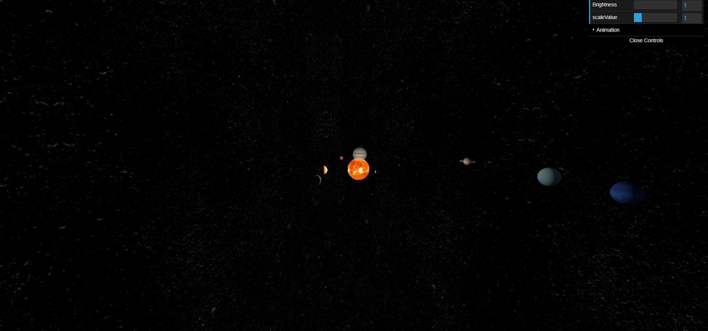

# 3D Solar System

An interactive 3D Solar System built using **Three.js** and **JavaScript**, featuring textured planets, planetary rotation, orbital movement, and an interactive control panel.

The project was developed to explore 3D graphics, animations, lighting, textures, and camera controls using Three.js.


## Demo Video

Watch the project in action:
[▶ Watch the Konark Wheel Demo](SolarSystemPreview.gif)

## Preview


## Features

- **3D Solar System:** A 3D scene featuring the Sun and eight planets.
- **Planetary Textures:** Individual textures for each planet.
- **Planetary Animation:** Rotation of planets and revolution around the Sun.
- **Saturn's Rings:** Textured rings created using Three.js geometry.
- **Space Background:** Star-filled environment using CubeTextureLoader.
- **Camera Controls:** OrbitControls for rotating and zooming around the scene.
- **Interactive GUI:** dat.GUI controls for adjusting:
  - Solar System scale
  - Scene brightness
  - Animation speed
  - Animation pause and resume

## Technologies Used

- HTML5
- CSS3
- JavaScript (ES6 Modules)
- Three.js
- dat.GUI
- Parcel

## Project Structure

```text
3D-Solar-System/
│
├── src/
│   ├── img/
│   │   ├── stars.jpg
│   │   ├── sun.jpg
│   │   ├── mercury.jpg
│   │   ├── venus.jpg
│   │   ├── earth.jpg
│   │   ├── mars.jpg
│   │   ├── jupiter.jpg
│   │   ├── saturn.jpg
│   │   ├── saturn_ring.png
│   │   ├── uranus.jpg
│   │   └── neptune.jpg
│   │
│   ├── index.html
│   ├── index.js
│   └── style.css
│
├── .gitignore
├── package.json
├── package-lock.json
└── README.md
```

## Installation and Setup

Follow these steps to run the project locally.

### 1. Clone the repository

```bash
git clone YOUR_REPOSITORY_URL
```

### 2. Navigate to the project directory

```bash
cd 3D-Solar-System
```

### 3. Install dependencies

```bash
npm install
```

### 4. Start the development server

```bash
npm run dev
```

Parcel will start the development server and provide a local URL to view the project in your browser.

### 5. Build for production

To generate an optimized production build, run:

```bash
npm run build
```

The production files will be generated inside the `dist` directory.

## Learning Outcomes

Through this project, I explored:

- Creating 3D scenes using Three.js.
- Working with geometries, materials, and textures.
- Implementing lighting in a 3D environment.
- Using Object3D and Groups to manage planetary movements.
- Implementing camera controls with OrbitControls.
- Creating animations using the Three.js rendering loop.
- Adding interactive controls using dat.GUI.
- Managing assets and modules using Parcel.

## Author

**Joyjeet Roy**

- GitHub: [Your GitHub Profile](https://github.com/JoyjeetR)
- LinkedIn: (https://www.linkedin.com/in/joyjeetroy/)

---

*Built as a learning project to explore 3D web development with Three.js.*
